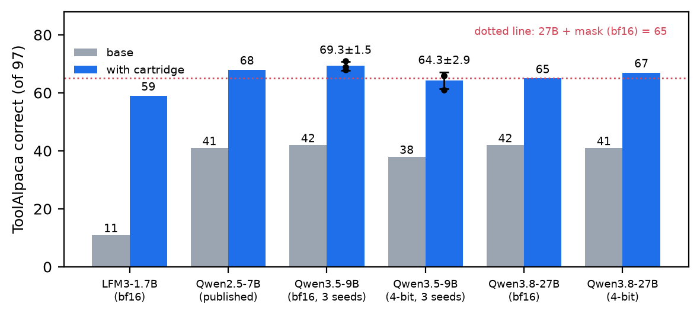
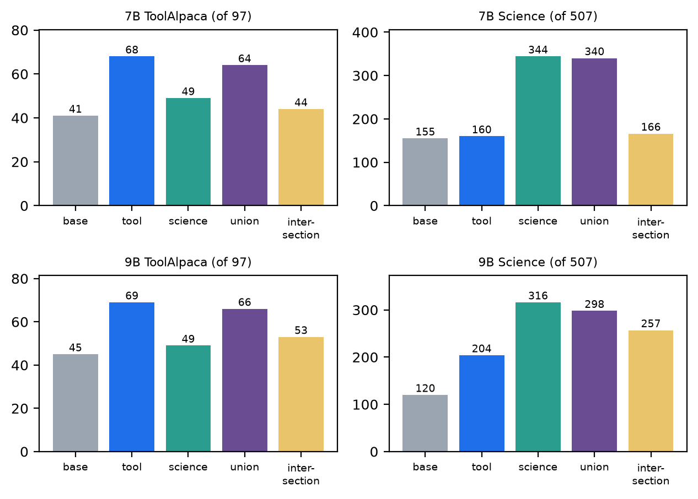

# Skill Cartridges

**Composable, hot-swappable deletion masks for small language models.**

A *skill cartridge* is a [Deletion Tuning](https://arxiv.org/abs/2611.10866) mask: a small file that switches off a
fraction of a percent of a model's MLP gate-projection weights and makes the model better at one skill. You apply it to
a frozen base model at request time and eject it to get the base weights back bit for bit. No weights are trained or
written; the mask only deletes.

- 📄 Paper: [`paper/skill-cartridges.pdf`](paper/skill-cartridges.pdf) (source in [`paper/`](paper/))
- 🤗 Cartridges: [huggingface.co/austindixson/skill-cartridges](https://huggingface.co/austindixson/skill-cartridges)

## Credit first

The training method is **Deletion Tuning** by Jack Lu, Zhenbang Yang, Mike Lasby, Tejas Pote, Yani Ioannou and
Mengye Ren, *The Surprising Effectiveness of Deleting Weights in LLM Post-Training*
(NeurIPS 2026, [arXiv:2611.10866](https://arxiv.org/abs/2611.10866), code:
[agentic-learning-ai-lab/deleting-weights](https://github.com/agentic-learning-ai-lab/deleting-weights), MIT).
The objective, sigmoid relaxation and sharpness schedule, Wanda initialization, regularizer, mask file format and the
ToolAlpaca/Science settings are theirs. So is the idea of combining masks by union, which they proposed as future work.
The ToolAlpaca and Science data and scorers come from Shenfeld et al.,
[*Self-Distillation Enables Continual Learning*](https://arxiv.org/abs/2601.19897)
([idanshen/Self-Distillation](https://github.com/idanshen/Self-Distillation)).

What this repo adds is measurement and tooling: three-seed replication and mask-overlap analysis on Qwen3.5-9B, a
9B-vs-27B comparison, a live apply/eject loader for 4-bit MLX models on Apple silicon, union stacking tests, a second
architecture (LiquidAI LFM3-1.7B), a recall cartridge, a forgetting/perplexity/KL check on the 27B cartridge, and a
negative result for code.

## Results (from the paper)

ToolAlpaca exact match, 97 test items. Gained/lost are paired against the base on the same items; *p* is an exact
two-sided McNemar test.

| Model | Precision | Base | Cartridge | Gained / lost | McNemar *p* | Deleted |
|---|---|---|---|---|---|---|
| Qwen3.5-9B, seed 1 | bf16 | 42 | 69 | 27 / 0 | 1.5e-8 | 0.6645% |
| Qwen3.5-9B, seed 2 | bf16 | 42 | 71 | 30 / 1 | 3.0e-8 | 0.6799% |
| Qwen3.5-9B, seed 3 | bf16 | 42 | 68 | 26 / 0 | 3.0e-8 | 0.6718% |
| Qwen3.5-9B, seed 1 | MLX 4-bit | 38 | 66 | 28 / 0 | 7.5e-9 | 0.6645% |
| Qwen3.5-9B, seed 2 | MLX 4-bit | 38 | 66 | 28 / 0 | 7.5e-9 | 0.6799% |
| Qwen3.5-9B, seed 3 | MLX 4-bit | 38 | 61 | 24 / 1 | 1.5e-6 | 0.6718% |
| Qwen3.8-27B (run 1) | bf16 | 42 | 65 | 29 / 6 | 1.2e-4 | 0.5037% |
| Qwen3.8-27B (run 1) | MLX 4-bit | 41 | 67 | 28 / 2 | 8.7e-7 | 0.5037% |
| LFM3-1.7B | bf16 | 11 | 59 | 48 / 0 | 7.1e-15 | 0.713% |

Other cartridges and checks:

| What | Result |
|---|---|
| 9B Science (SciKnowEval Chem L-3, 507 items, MLX bf16) | 120 → 316 (211 gained, 15 lost) |
| 9B latest-value recall (synthetic, 200 items) | 89 → 200; longer held-out format (100 items): 8 → 100. Seed 2: 90 → 200, 8 → 99 |
| Union stacking, 9B tool + science | keeps 87.5% of the tool gain (45 → 69 alone, 66 union) and 90.8% of the science gain (120 → 316 alone, 298 union) |
| Union stacking, published 7B masks | keeps 85% of the tool gain and 97.9% of the science gain |
| Seed overlap, 9B ToolAlpaca | pairs share 12.8–13.2× the chance overlap; 777,898 weights deleted by all three seeds vs 489 expected |
| 4-bit live toggle, 9B | warm apply 0.04 ms, eject 0.10 ms; eject restores every touched array byte for byte |
| Forgetting, 27B cartridge, 4-bit (HellaSwag, MMLU, ARC-C, WinoGrande; 34% subset) | mean −0.76 points (95% CI −1.41 to −0.13), no task down more than 1.2 |
| WikiText-2 perplexity, 27B 4-bit | 7.5956 off → 7.5712 on |
| **Negative result:** 9B code (MBPP-trained) | MBPP 349 → 293 / 500, HumanEval 139 → 114 / 164. Not distributed. |

Read the paper's limitations section before relying on any of this: ToolAlpaca is small (97 items), part of every
exact-match gain may be formatting (for LFM3, a large part), the 9B and 27B are different Qwen generations, and there is
no LoRA baseline yet.




## Repository layout

| Path | What |
|---|---|
| `train/train_toolalpaca.py` | Hugging Face Jobs training script for the 9B ToolAlpaca seeds (PEP 723, pinned upstream commits) |
| `train/train_toolalpaca_27b.py` | The same recipe as used for the 27B run (2-GPU layer split) |
| `train/train_science.py` | Science cartridge |
| `train/train_tasks.py` | Recall (`--task memory`), code (`--task code`) and LFM3 ToolAlpaca |
| `train/launch_hf_job.sh` | Reference `hf jobs uv run` launcher (set `HF_NAMESPACE`) |
| `train/analyze.py`, `train/test_scorers.py` | Paired stats on a finished run; scorer self-tests |
| `mlx/cartridge.py` | Decode a mask, union/intersection, live apply/eject on bf16 MLX models |
| `mlx/quant_cartridge.py` | Live apply/eject on affine 4-bit MLX models (nearest-zero and requantize forms) |
| `mlx/run_eval.py` | ToolAlpaca/Science eval with masks toggled in memory, several conditions per model load |
| `mlx/swap_bench.py` | Apply/eject timing and exact-restore check |
| `mlx_eval_27b/` | 27B 4-bit evaluation: ToolAlpaca, off-task retention, WikiText-2 perplexity and KL, throughput |
| `analysis/` | Mask overlap (Jaccard vs chance), McNemar stats, the tables in the paper |
| `paper/` | LaTeX source, bibliography, figures and `make_figures.py` |

Scripts that read local results use `SC_ROOT` (default `.`) for the folder that holds masks and result directories.

## Using a cartridge

Download one from Hugging Face:

```bash
hf download austindixson/skill-cartridges --include "qwen3.5-9b/toolalpaca-seed1/*" --local-dir cartridges
```

### MLX, 4-bit (Apple silicon)

```python
import sys; sys.path.insert(0, "mlx")
from mlx_lm import load
import cartridge, quant_cartridge as qc

model, tok = load("mlx-community/Qwen3.5-9B-MLX-4bit")
keep = cartridge.load_mask("cartridges/qwen3.5-9b/toolalpaca-seed1/mask")   # layer -> bool keep array

saved = qc.apply_nearest_zero(model, keep)   # cartridge in; kept weights are untouched
# ... generate ...
qc.eject(model, saved)                        # base model back, bit for bit
```

Stack two cartridges with `cartridge.combine([keep_a, keep_b], "union")`. For a bf16 MLX model use
`cartridge.apply_dense` / `cartridge.eject_dense`. The MLX apply functions target Qwen-style `mlp.gate_proj` layers; `load_mask` also decodes
the LFM3 mask (`feed_forward.w1`), which we applied in PyTorch.

### PyTorch / transformers

Masks use the upstream `packbits_zstd` format, so upstream's
[`src/apply_mask.py`](https://github.com/agentic-learning-ai-lab/deleting-weights) applies them directly. Each mask
layer is `model.layers.{L}.mlp.gate_proj.weight.{shape,packed}` (`feed_forward.w1` for LFM3), where `packed` is
`zstd(np.packbits(keep))` and bit 1 = keep.

## Evaluation data

ToolAlpaca and Science data and scorers are **not** included. They belong to the SDFT authors' repository, which has
no license file. The training scripts fetch it at the pinned commit `d77573212fa0a3ae2eeb64b9b44db1c251f75e3e`; for
the MLX evals, clone it to `vendor/Self-Distillation` (or set `SDFT_DIR`) at that commit:

```bash
git clone https://github.com/idanshen/Self-Distillation vendor/Self-Distillation
git -C vendor/Self-Distillation checkout d77573212fa0a3ae2eeb64b9b44db1c251f75e3e
```

## Reproducibility

Upstream `deleting-weights` @ `94f0340ebb574f95bb41d844165253a6785e215e`. Training: torch 2.15.0 (CUDA 13.2),
transformers 5.22.2, accelerate 1.15.0, datasets 5.2.0, safetensors 0.8.0, zstandard 0.25.0,
flash-linear-attention 0.6.0, one RTX PRO 6000 (96 GB) on Hugging Face Jobs (two for the 27B). A 9B run takes about
13 minutes and costs about $0.60. Inference: MLX 0.32.4, mlx-lm 0.32.2. Hyperparameters are in the paper's appendix.

## License

- **Code:** MIT (the same license as upstream Deletion Tuning; upstream's notice is kept in [`LICENSE`](LICENSE)).
- **Cartridges** (on Hugging Face): each follows its base model's license. Qwen masks are Apache-2.0; the LFM3-1.7B
  mask is distributed under the LFM Open License v1.0.
- **Paper and figures:** © 2026 Austin Dixson.

## Citation

```bibtex
@misc{dixson2026skillcartridges,
  title  = {Skill Cartridges: Composable, Hot-Swappable Deletion Masks for Small Language Models},
  author = {Dixson, Austin},
  year   = {2026},
  url    = {https://github.com/austindixson/skill-cartridges}
}

@inproceedings{lu2026deleting,
  title     = {The Surprising Effectiveness of Deleting Weights in {LLM} Post-Training},
  author    = {Lu, Jack and Yang, Zhenbang and Lasby, Mike and Pote, Tejas and Ioannou, Yani and Ren, Mengye},
  booktitle = {Advances in Neural Information Processing Systems (NeurIPS)},
  year      = {2026},
  note      = {arXiv:2611.10866}
}
```
